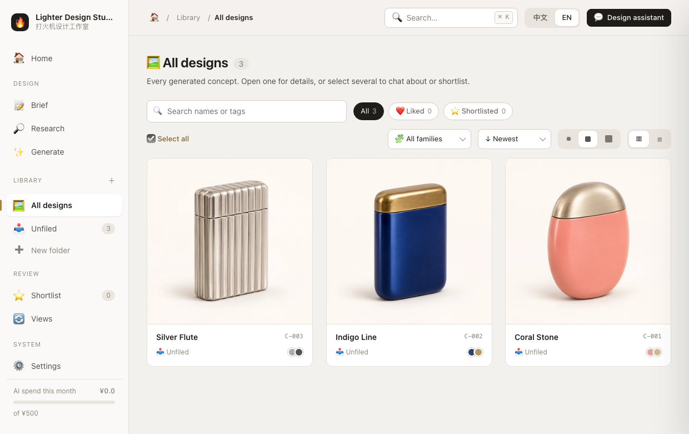

# Lighter Creation Studio

A bilingual workspace for reviewing pocket lighter design concepts. Browse a set of finishes, open a design to inspect its palette, and save notes as you narrow down a shortlist. Switch between English and 简体中文 at any point.



## Try it

With Node.js 22 and npm installed, run these commands from the repository root.

```sh
npm ci
npm run dev
```

Open the local URL printed by Vite. Select **EN** or **中文** in the top bar, then open **All designs / 全部方案**. Click a card to edit its names, add a note, or shortlist it. Press **/** to search the library.

## How the demo works

The gallery ships with three concept illustrations created for this public demo. Folders, notes, likes, shortlists and language preferences are saved in the current browser. The app runs locally without an account or API key.

The generation queue, research, design chat and alternate-view screens illustrate a proposed workflow using simulated data. Provider names and cost figures in those screens are examples.

Built with React, TypeScript and Vite. Run `npm run build` to type-check the app and produce a static build in `dist/`.
